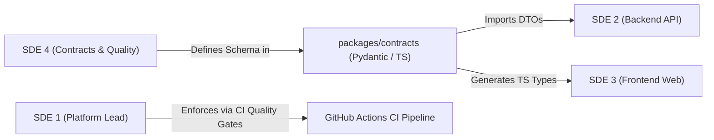

# 4-Track Engineering Ownership & Architecture

This repository is structured for **4 concurrent Software Development Engineers (SDEs)** working autonomously on distinct tracks without merge conflicts, contract drift, or architectural silos.

---

## Track Matrix

| Track | Role | Core Focus | Primary Codebase Footprint |
| :--- | :--- | :--- | :--- |
| **Track 1** | **Platform & Infrastructure Lead** | Cloud, Docker, CI/CD, DB migrations, core config, security | `infra/`, `.github/`, `packages/common/config.py`, root config |
| **Track 2** | **Backend Core & Engine Lead** | Business domain services, business logic, algorithms, repos | `apps/api/src/api/endpoints/`, `apps/api/src/services/` |
| **Track 3** | **Frontend & User Experience Lead** | Modern Web UI, component library, client state, API client | `apps/web/` |
| **Track 4** | **Contracts, Quality & Systems Lead** | Canonical schemas, DTOs, integration tests, benchmarks | `packages/contracts/`, `**/tests/`, `scripts/` |

---

## Contract-First Development Protocol

1. **Zero Guesswork**: Backend and Frontend never develop against assumptions. Every endpoint and message contract is defined first in `packages/contracts`.
2. **Contract Freeze**: Once merged to `develop` or `main`, contracts cannot have breaking changes without a version bump (`v1` -> `v2`) and unanimous cross-track sign-off.
3. **Mock Independence**: Frontend SDE can mock API calls immediately using strongly typed contracts without waiting for backend implementation.
